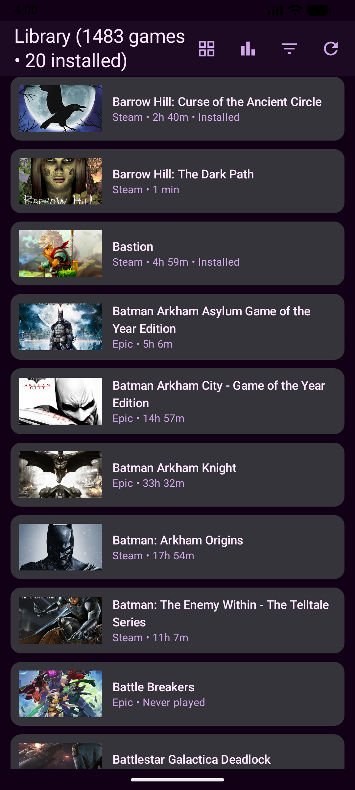
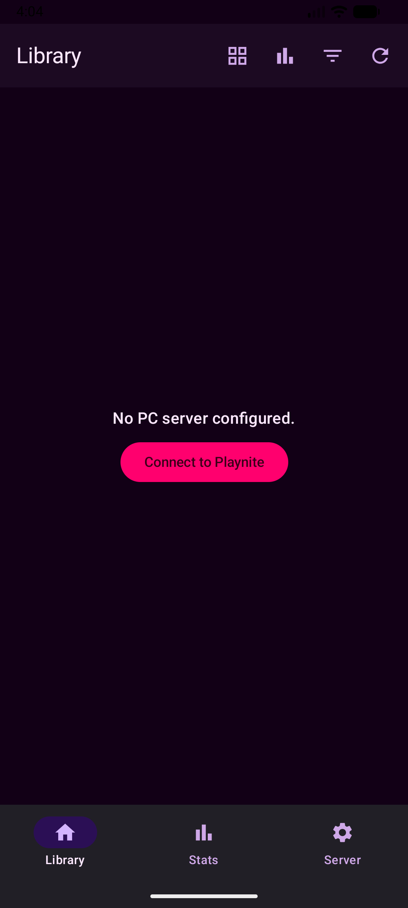
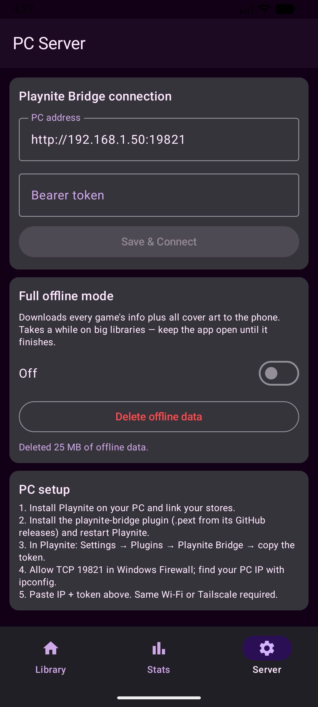
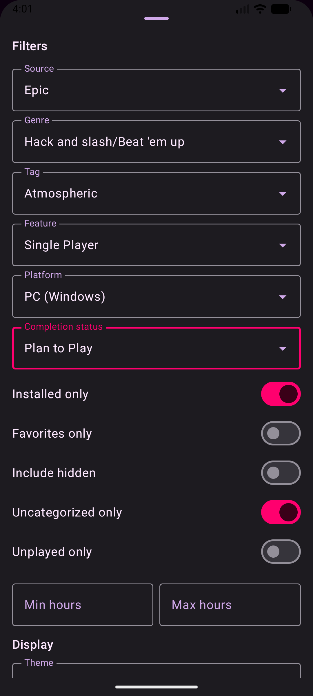
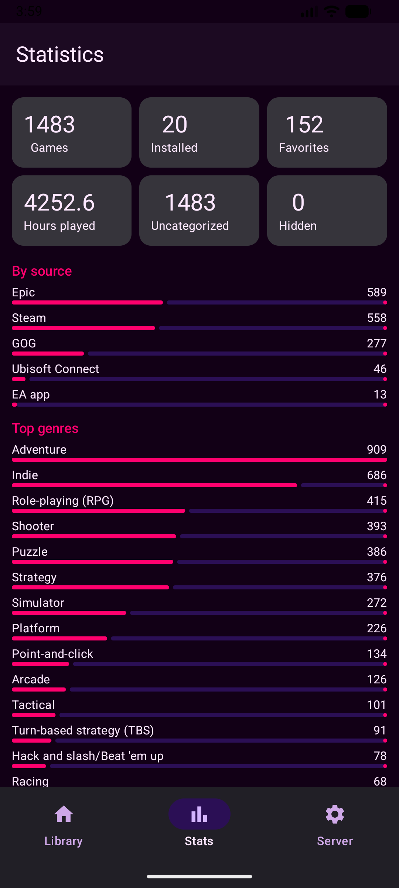

# Playnite Remote (Android client for playnite-bridge)

Browse your entire PC game library -- Steam, Epic, GOG, Ubisoft, EA, and everything else Playnite tracks -- from your Android phone.

**Architecture:** Playnite runs on your PC and already handles every store login (verified against its own plugin source). The open-source [`playnite-bridge`](https://github.com/rollacode/playnite-bridge) plugin (MIT) exposes the library as a REST API on port 19821. This app is a thin client for that API: one server address + one token, no per-store logins.

```
PC:  Playnite + library plugins + playnite-bridge :19821 (Bearer token)
            +-- LAN / Tailscale --+
Phone: this app (library, search, covers, details, launch-on-PC)
```

## Screenshots

**Four emulator captures in a single row:**

| Dashboard listing (big icons) | Actual offline | Settings connection | Filters |
|---|---|---|---|
|  |  |  |  |

| Dashboard listing (big icons) | Stats | Stats |  Stats |
|---|---|---|---|
|  | |  |  |

### Connection screenshots (side-by-side)

| Empty/offline | Settings (connection form) | Connection steps |
|---|---|---|
|  |  | 1. Install Playnite on the PC. 2. Install the PlayniteBridge `.pext` and copy its token. 3. On phone: Server tab `http://<PC-IP>:19821` + token -> **Save & Connect**. |

## PC setup

1. Install Playnite, link your stores, let it import your library.
2. Download `PlayniteBridge_vX.X.X.pext` from the playnite-bridge GitHub releases, drag it onto Playnite, restart. The API starts on port **19821**.
3. In Playnite: **Settings -> Plugins -> Playnite Bridge** -> copy the bearer token.
4. Allow **TCP 19821** through Windows Firewall. Find your PC's LAN IP with `ipconfig`.
5. For access outside home: use Tailscale on both devices, then use the Tailscale IP.

## App setup

1. Open this folder in Android Studio, sync Gradle, run on your phone (minSdk 26).
2. Open the **Server** tab -> enter `http://<PC-IP>:19821` + token -> **Save & Connect**.
3. The **Library** tab loads everything. Sources come live from `GET /api/sources`, so new stores appear automatically.

## API mapping (playnite-bridge -> app feature)

| Endpoint | Used for |
|---|---|
| `GET /api/games?limit=&offset=` (paged) | Full library, search/sort client-side |
| `GET /api/sources` | Store filter chips |
| `GET /api/stats` | Library header count |
| `GET /api/games/{id}` | Detail dialog (devs, scores, links) |
| `GET /api/games/{id}/cover?type=cover\|background` | Artwork (authenticated Coil loader) |
| `POST /api/games/{id}/launch` | "Launch on PC" button |
| `PUT /api/games/{id}` | Favorite star toggle |
| `GET /api/games/{id}/achievements` | SuccessStory progress + list (when plugin data exists) |
| `GET /api/games/{id}/activity` | GameActivity sessions (when plugin data exists) |
| `GET /api/stats` | Stats tab: totals, hours, by-source/genre/status bars, recently played |

List and grid views (toggle in the top bar) with an adjustable 2--5 column
slider in grid mode. View mode and column count persist on the phone.
Page sizes 50 / 100 / 200 / All ("Show" dropdown) with a pager, persisted too.
Only rows near the visible screen load images (viewport-gated), which keeps
fast scrolls from flooding the PC. **Keep all images** (filter sheet ->
Display) bypasses that: it pulls every cover of the current view onto the
phone and never unloads rows, so scrolling back up never reloads.

Three themes (filter sheet -> Display -> Theme): Default (follows system),
Midnight neon dark, and Forest green. The choice persists.

Search, sort, page-size, filters, and pager live inside the scrolling list
itself -- they scroll away naturally and take zero reserved space, so the
library is full-bleed. The bottom tab bar slides away while scrolling down
and returns on scroll up or tab switch.

Filtering uses every list filter the API documents (skill.md `GET /api/games`
+ `POST /api/games/query`): text, source, genre, category, tag, feature,
platform, completion status, installed, favorite, hidden, uncategorized,
unplayed, playtime min/max hours -- plus sorting by name, playtime,
last played, score, source. Facet dropdowns are multi-select with checkboxes
(OR within a facet, AND across facets). Filtering runs client-side over the synced
snapshot, so it works fully offline. Facet dropdowns are built from your
own library. Developer/publisher/release-year facets are intentionally
skipped: those fields only exist in per-game details, which would need one
extra request per game at sync time.

Auth: `Authorization: Bearer <token>` on every call, including images. Reads of `docs/api.md`/`skill.md` and the plugin `Router.cs`/`GameSerializationService.cs` confirm field names (`playtime` is seconds, `source` is a display name string).

## Offline support

Every successful sync snapshots the library (`games`, sources, stats) to internal storage, and covers are kept in a 250 MB Coil disk cache. Behavior:

- App opens instantly from the snapshot, then refreshes in the background.
- PC unreachable + snapshot present -> amber "Offline -- library from "" banner, full browsing/search/sort still works.
- Game details are cached lazily when opened; uncached details need the PC.
- Launch-on-PC always needs a live connection.
- Disconnecting keeps the snapshot browsable; reconnecting refreshes it.

## Full offline mode (Server tab)

For flights and dead zones: the **Full offline mode** switch downloads
everything up front -- full info for every game, then all cover art into a
1 GB disk cache. Progress shows per phase (`Game info n/total`, `Covers n/total`)
and only finishes when every cover is actually downloaded; cancel keeps
partial progress, and re-running refills the gaps. Backgrounds
stay on-demand (they're too big to prefetch for thousands of games) but are
cached whenever viewed. Re-run **Refresh offline data** after big library
changes.

Games with no art on the PC are learned (`hasCover=false` in full details,
plus any live 404 while scrolling) and never requested again -- neither while
scrolling nor during cover prefetch. Those repeat 404s were the flood behind
the bridge errors. Image requests are also viewport-gated: only rows near
the visible screen may load; anything scrolled past never fires.

**Delete offline data** (same card, red button, with confirmation) wipes the
snapshot, cached details, downloaded covers and the artless set, reporting
how much space was freed. The server connection is kept.

Requests are deliberately gentle, in layers: viewport-gated image loading
(only near-visible rows fetch), artless games never requested, a separate
2-at-a-time image lane that can't crowd out API calls, no silent retries,
~75 ms pacing on bulk downloads -- and a circuit breaker: 8 failing (non-404)
image requests in a minute pauses all image loading for a minute.

## Security

The token grants **full control**: launch, install, uninstall, delete, and remote C# eval (`/api/eval`). Treat it like a password. Use only on trusted LAN or Tailscale, and rotate it in plugin settings if it ever leaks. Never port-forward 19821 to the internet.

Cleartext HTTP is enabled (`usesCleartextTraffic="true"`) because the bridge serves plain HTTP on LAN. If you reverse-proxy it behind HTTPS, switch the address to `https://`.

## Project structure

```
app/src/main/java/com/gamevault/unified/
  MainActivity.kt (authenticated Coil ImageLoader via LocalImageLoader)
  GameVaultApp.kt (ServerStorage + GameRepository wiring)
  data/model/       Game.kt, GameDetails, ServerConfig.kt
  data/remote/      BridgeApi.kt (Retrofit + DTOs), BridgeClient.kt (auth interceptor)
  data/local/       ServerStorage.kt (URL + token in DataStore)
  data/repository/  GameRepository.kt (paging, sources, details, launch, test)
  viewmodel/        LibraryViewModel.kt
  ui/navigation/    AppNav.kt (Library / Server)
  ui/screens/       LibraryScreen.kt, ServerScreen.kt
```

## Hardened bridge (optional)

If you want the Playnite-side stability improvements, install the drop-in replacement bridge server:

- Release: https://github.com/damianoshar/playnite-bridge/releases/tag/v1.6.0
- Features: request gate (max 12 concurrent + single-flight), global SDK gate, 256MB cover cache, strong ETags, 304 handling, hardened HTTP error path.
- API byte-compatible with upstream 1.5.3 (same routes/params/status code), so this client works with either.


## Credits

- [Playnite](https://github.com/JosefNemec/Playnite) (MIT) -- library aggregation on PC.
- [playnite-bridge](https://github.com/rollacode/playnite-bridge) (MIT) -- REST API plugin this client consumes.
